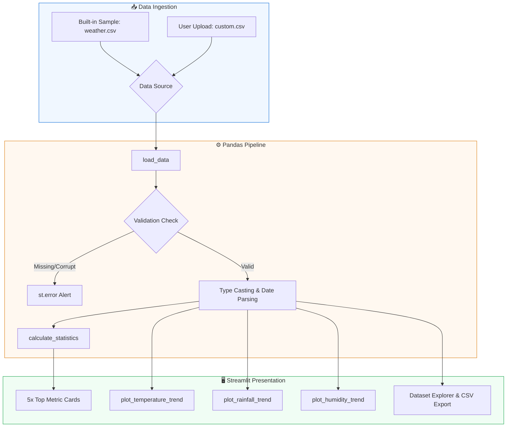

<div align="center">

# 🌤️ Weather Data Analysis Dashboard

### *A modern, interactive, and beginner-friendly climate analytics tool built with Python, Streamlit, Pandas & Matplotlib.*

<p align="center">
  <a href="#-quick-start">
    
  </a>
  <a href="#-tech-stack">
    
  </a>
  <a href="#-tech-stack">
    
  </a>
  <a href="#-tech-stack">
    
  </a>
  <a href="#-license">
    
  </a>
</p>

<p align="center">
  <b>Instant Setup</b> • <b>Zero Database Required</b> • <b>Preloaded 31-Day Dataset</b> • <b>Drag-and-Drop CSV Support</b>
</p>

---

</div>

## 📑 Table of Contents

- [✨ Features](#-features)
- [🏗️ System Architecture](#️-system-architecture)
- [🖥️ Dashboard Preview & Layout](#️-dashboard-preview--layout)
- [📁 Project Structure](#-project-structure)
- [🛠️ Tech Stack](#️-tech-stack)
- [⚡ Quick Start](#-quick-start)
- [📊 CSV Dataset Specification](#-csv-dataset-specification)
- [🛡️ Error Handling & Validation](#️-error-handling--validation)
- [🤝 Contributing](#-contributing)
- [📜 License](#-license)

---

## ✨ Features

| Feature | Description |
| :--- | :--- |
| **🚀 Instant Execution** | Bundled with `weather.csv` (31 days of synthetic weather data) so it works out-of-the-box. |
| **📊 Real-time Metric Cards** | Top-level summary cards displaying Average Temp, Max Temp, Min Temp, Humidity, and Total Rainfall. |
| **📈 Dynamic Matplotlib Charts** | Clean, responsive charts including temperature line plots, rainfall bars, and humidity curves. |
| **📂 Custom CSV Ingestion** | Sidebar file uploader accepting any valid CSV dataset. |
| **📋 Formatted Data Explorer** | Tabular view of records with custom numerical formatting and one-click CSV export. |
| **🛡️ Robust Input Validation** | Graceful error prevention for missing headers, unparseable dates, and null values. |

---

## 🏗️ System Architecture



---

## 🖥️ Dashboard Preview & Layout

1. **Header & Context Banner**: Displays status badge distinguishing sample data from uploaded files.
2. **Top Metric Bar**:
   - `Avg Temperature`: Mean temperature across the observation period.
   - `Max Temperature`: Peak recorded high.
   - `Min Temperature`: Lowest recorded temperature.
   - `Avg Humidity`: Mean relative humidity percentage.
   - `Total Rainfall`: Cumulative precipitation in millimeters.
3. **Visual Analytics Grid**:
   - **Temperature Over Time**: Dual-styled line plot with daily points and mean threshold dashed line.
   - **Daily Rainfall**: High-contrast bar chart depicting daily precipitation.
   - **Humidity Over Time**: Color-coded line plot capped at 100% relative humidity.
4. **Interactive Data Table**:
   - Full dataset inspection with unit symbols (`°C`, `%`, `mm`).
   - `📥 Download Current Data as CSV` action button.

---

## 📁 Project Structure

```text
weather-analysis/
├── app.py             # Streamlit application with UI, logic, and charts
├── weather.csv        # 31-day synthetic sample dataset (May 1 – May 31, 2026)
├── requirements.txt   # Core Python package dependencies
├── .gitignore         # Git ignore rules for virtualenvs and caches
└── README.md          # Comprehensive project documentation
```

---

## 🛠️ Tech Stack

- **Python** `3.8+` — Core language
- **Streamlit** `^1.30.0` — Modern web UI framework
- **Pandas** `^2.0.0` — High-performance data manipulation and parsing
- **Matplotlib** `^3.8.0` — Publication-ready charting and figures

---

## ⚡ Quick Start

### 1. Clone or Download the Repository

```bash
git clone https://github.com/rehan3011/weather-analysis.git
cd weather-analysis
```

### 2. Set Up a Virtual Environment

**Windows (PowerShell):**
```powershell
python -m venv venv
.\venv\Scripts\Activate.ps1
```

**macOS / Linux:**
```bash
python3 -m venv venv
source venv/bin/activate
```

### 3. Install Dependencies

```bash
pip install -r requirements.txt
```

*(Or via [uv](https://github.com/astral-sh/uv): `uv pip install -r requirements.txt`)*

### 4. Run the Dashboard

```bash
streamlit run app.py
```

Your browser will automatically open:
```text
http://localhost:8501
```

---

## 📊 CSV Dataset Specification

When supplying your own dataset via the sidebar, ensure the file contains the following four columns:

| Column Name | Required Type | Example Format | Details |
| :--- | :--- | :--- | :--- |
| `Date` | Date String | `2026-05-01` | Daily date timestamp (`YYYY-MM-DD` recommended) |
| `Temperature` | Float / Integer | `24.5` | Recorded temperature in Celsius (°C) |
| `Humidity` | Float / Integer | `65` | Relative humidity percentage (`0`–`100%`) |
| `Rainfall` | Float / Integer | `12.4` | Daily rainfall precipitation in millimeters (mm) |

### Sample CSV Excerpt

```csv
Date,Temperature,Humidity,Rainfall
2026-05-01,22.5,65,0.0
2026-05-02,23.1,63,0.0
2026-05-03,24.0,60,0.0
2026-05-04,21.8,72,4.2
2026-05-05,20.2,85,14.5
```

> [!NOTE]
> The included `weather.csv` dataset consists of synthetic data created for educational demonstration and testing purposes.

---

## 🛡️ Error Handling & Validation

The application incorporates multi-layered validation:

- **Missing Header Detection**: Clearly informs which required columns are absent.
- **Empty File Protection**: Rejects zero-byte or header-only files with clear alerts.
- **Type Coercion**: Automatically flags invalid dates or non-numeric entries.
- **Null Cleaning**: Automatically strips corrupted rows and alerts the user with the number of excluded records.

---

## 🤝 Contributing

Contributions are always welcome!
1. Fork the Project.
2. Create your Feature Branch (`git checkout -b feature/NewFeature`).
3. Commit your Changes (`git commit -m "Add NewFeature"`).
4. Push to the Branch (`git push origin feature/NewFeature`).
5. Open a Pull Request.

---

## 📜 License

Distributed under the **MIT License**. See `LICENSE` for more information.

